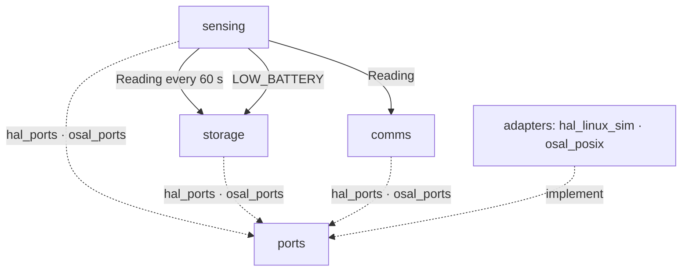

# firmware · system

The station firmware image. Application modules talk to hardware only through ports
(`ports/`); adapters (`adapters/`) implement them per platform; `targets/linux-sim` is the
composition root that builds everything natively for tests.

## Subsystems and interactions

## Architecture
One 100 ms tick task (battery sampling, storage guard) and one 60 s task (humidity, record, uplink).
No dynamic allocation after start-up.

## Platform
STM32F4 board (not modelled in this example) and `linux-sim` for every module test.

## Build and toolchain
C++17. `targets/linux-sim/run-module-tests.sh` builds one module's tests with the host `c++`.
