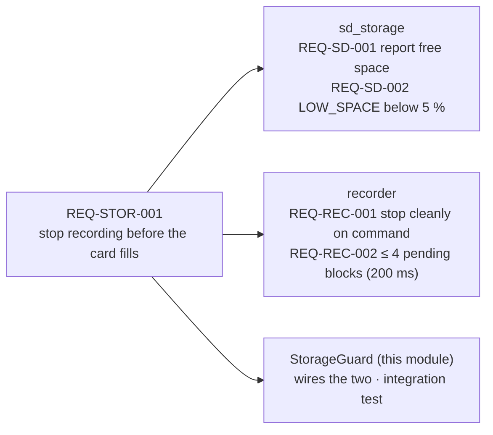

# storage · system

Storage subsystem. Shows **requirement decomposition**: the firmware rule "stop recording before
the SD card fills" is split into the part each child can own and test; the parent keeps the rule
that connects them (`StorageGuard`) and its integration test.

