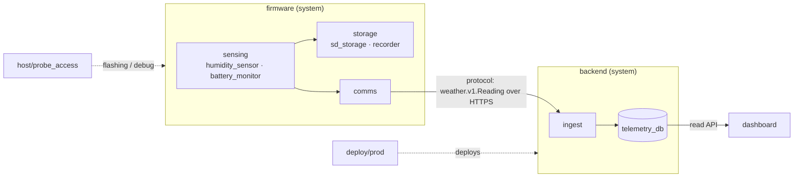

# weather-station · system

> **Example project** for [modgate](../../modgate.md). It is never deployed; it exists to show the
> whole structure at once. Every hash, trace file and test record here was produced by the real tool.

A small solar weather station: firmware samples humidity and battery, records to an SD card and
uploads readings; a backend stores them; a dashboard shows them.

## Subsystems and interactions

## How to read this example
| Look at | To see |
|---|---|
| `modgate.yaml` | project settings: criticality L2, targets `linux-sim`, `host`, `web` |
| `firmware/storage/` | requirement decomposition: REQ-STOR-001 split into `sd_storage` + `recorder`, integration test in the parent |
| `firmware/ports/hal_ports/fakes/` | test doubles living with the port they fake, used by several modules |
| `firmware/sensing/study_adc_noise_floor/` | a `study` module at L0 (criticality override) |
| any `docs/<m>.trace.md` | generated matrix FEAT → REQ → TC → result, and modgate's state block |
| `modgate pending` | the demonstrative mixed state below |

## Demonstrative state (what `modgate pending` shows)
- **DRAFT** `humidity_sensor.icd.md` v2 — an ICD change (read timing) awaiting the developer.
- **DRIFT** `battery_monitor` REQ-BATMON-002 — the brown-out debounce was changed from 1 s to 2 s in
  code and test, but the requirement still says 1 s: an unreviewed change.
- **BACKLOG** two queued features (`humidity_sensor`, `dashboard`).
Everything else is **verified**. Approver in this example: `Example Dev`.

## Running it
From this folder: `modgate pending`, `modgate pending --report`, `modgate sync --test linux-sim`
(needs `c++`), `--test host` (needs `python3` with pytest), `--test web` (needs node ≥ 23).
