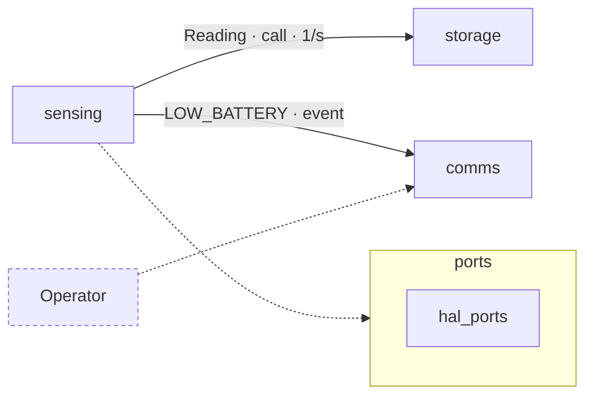

# Doc-comment and diagram conventions

What `W check` reads as documentation, and how to write it so the checks pass and the map panels read
well. The first sentence of every doc is its **brief** (≤ 200 chars): it shows in the map panel and in
search. Say what the thing does and in which units, not how.

## What counts as a doc

| language | doc | attaches to |
|---|---|---|
| Python | docstring (Google, NumPy or Sphinx) | the function, class or module it opens |
| C / C++ | `///`, `//!`, `/** */`, `/*! */`, any comment with `@cmd` or `\cmd`; plain `//` too | the next declaration, ≤ 1 blank line above, no code between; `///<` and `//!<` attach to the member before |
| JS / TS | `/** … */` (JSDoc) | the next declaration |
| Go | `// Name …` | the next declaration |
| Rust | `///` (item), `//!` (module) | the next item |
| proto, SQL | comment block above | the message, service, rpc or table |

A plain `//` comment counts as a doc (no UNDOC) but has no structured params, so DOCSIG never checks it.
In C/C++ the doc lives on the **header declaration**; the `.cpp` definition inherits it. Documenting both
is fine; the header wins in the map panel.

## Public means

- Python: no leading `_` in any part of the name, and listed in `__all__` when the module has one.
- C/C++: declared in a header (`.h .hh .hpp .hxx`), public access, not `static`, not in an anonymous,
  `detail` or `internal` namespace.
- JS/TS: exported and not `#private`/`private`. Go: capitalised. Rust: `pub`. Java/C#: `public`/`protected`.

UNDOC applies to public symbols in source dirs (modgate `sources:`, default `src/` and `include/`), never
to tests, vendored code, overrides (they inherit the base doc), test cases, macros, constructors and
destructors, `= default` members, property setters, Python dunders, or Python constants.

## Python

```python
"""Wire decoding for weather.v1.Reading (varint fields only)."""


def decode(data: bytes, *, strict: bool = True) -> dict:
    """Decode one Reading frame into a field dict.

    Implements REQ-INGEST-002.

    Args:
        data: raw frame bytes, at most 64 B.
        strict: reject unknown field numbers when true.

    Returns:
        Field name to integer value; timestamps in s, voltages in mV.

    Raises:
        DecodeError: the frame is truncated or a required field is missing.
    """
```
- Every non-test module gets a module docstring (one line is enough).
- `self`, `cls`, `*args`, `**kwargs` need no entry unless you choose to document them.

## C / C++

```cpp
/// @file battery_monitor.hpp
/// Battery voltage sampling and brown-out detection (REQ-BATMON-001).

/// Samples the battery voltage through the ADC divider, in mV.
/// @param now_ms monotonic time of this sample, in ms.
/// @return true when the low-battery flag changed on this call.
/// @see update_brownout
bool sample(uint32_t now_ms);

struct Reading {
  uint16_t rh_tenths;  ///< relative humidity, in 0.1 %RH
};
```
- `@param name` (also `@param[in] name`), `@return`/`@returns`, `@throws`, `@note`, `@deprecated`.
- One `@file` block per public header: what the header is for.

## JS / TS

```ts
/**
 * Formats a battery voltage for the dashboard banner.
 * @param mv - battery voltage in mV.
 * @param digits - decimals to show, 0–3.
 * @returns the text, e.g. "3.31 V". See {@link lowBatteryBanner}.
 */
export function formatMv(mv: number, digits = 2): string {
```

## Go and Rust

```go
// Hello returns the greeting shown on the status page.
func Hello() string {
```
```rust
/// Parses a station id from the config string.
///
/// # Errors
/// Returns `ParseError` when the id is not 1–8 ASCII digits.
pub fn parse_id(s: &str) -> Result<u32, ParseError> {
```

## Params: all or none

Once a doc names any parameter explicitly (`Args:`, `@param`, `:param x:`), it must name exactly the
signature's parameters, or DOCSIG fires: `doc names [n, mode], signature has [n, strict]`. Rename a
parameter → update its doc line in the same edit.

## Requirements and cross-references

- Cite requirements by id anywhere in the doc: `REQ-BATMON-002`. The map links the chip to the req doc.
- Tests carry REQ ids too: `TEST(Geo, REQ_GEO_001_area)`, `@pytest.mark.req("REQ-PKG-001")`,
  `test("REQ-DASH-003 shows the banner", …)`.
- Cross-refs are verified (DEADLINK): `@see X`, `\ref X`, `\sa X`, `{@link X}`, `:func:`X``,
  `:class:`X``, `:meth:`X``. `X` is a symbol name or a qualified name (`Recorder::stop`,
  `pkg.core.Engine`); trailing `()` is fine. `http(s)://` links are not checked.

## When the doc and the code disagree

The doc, the REQ and the ICD say what the code **should** do. If the code does something else (doc: every
1 s, code: every 2 s), do not edit the doc to match: raise it as a finding for the developer. Edit the doc
alone only when it was wrong about intent, and say so in the change.

`W ack <key> --unchanged "<why>"` confirms an unchanged doc is still true after a code change (DOCSTALE,
DOCREVIEW). Read the code first; the reason is logged and reviewed.

## Silencing a deliberate gap

- `wiki: ignore UNDOC` (or `wiki: ignore UNDOC,DEADLINK`) in a comment on the symbol's line or the line
  above silences those codes for that symbol.
- `wiki: skip` in the first 5 lines of a file drops UNDOC and DOCSIG for every symbol in it (generated
  code, thin shims).
- Each suppression needs a reason in the same comment: `# wiki: ignore UNDOC — generated from demo.proto`.

## Interaction diagrams

Each container (module or group) with 2 or more children has, in its overview (`X.md`, or README in
plain repos):

````markdown
## Subsystems and interactions


````
- First line of every node label = the exact module or group name (DIAGNODE otherwise). Extra lines may
  describe it: `G["storage<br/>SD ring buffer"]`.
- Every direct child module or group appears (UNDRAWN otherwise). Draw a group as a `subgraph`.
- Edge labels are `what · how · rate`, ≤ 48 chars. `-->` is a data or control flow; `-.->` means uses,
  deploys or debugs.
- `:::ext` marks actors outside the repo (people, cloud services, hardware). A node labelled with a REQ id
  is shown as a requirement.
- ≤ 12 nodes. Split the container if it needs more.
- Change the diagram in the same edit that adds a dependency or a cross-module call.
- Modgate repos: the overview is a controlled doc: version +1, `status: draft`, changelog entry. Never
  approve it yourself.
- Don't draw a separate SVG of the same diagram; the Systems view renders it.
