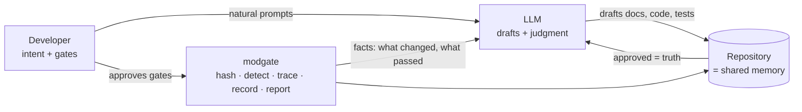
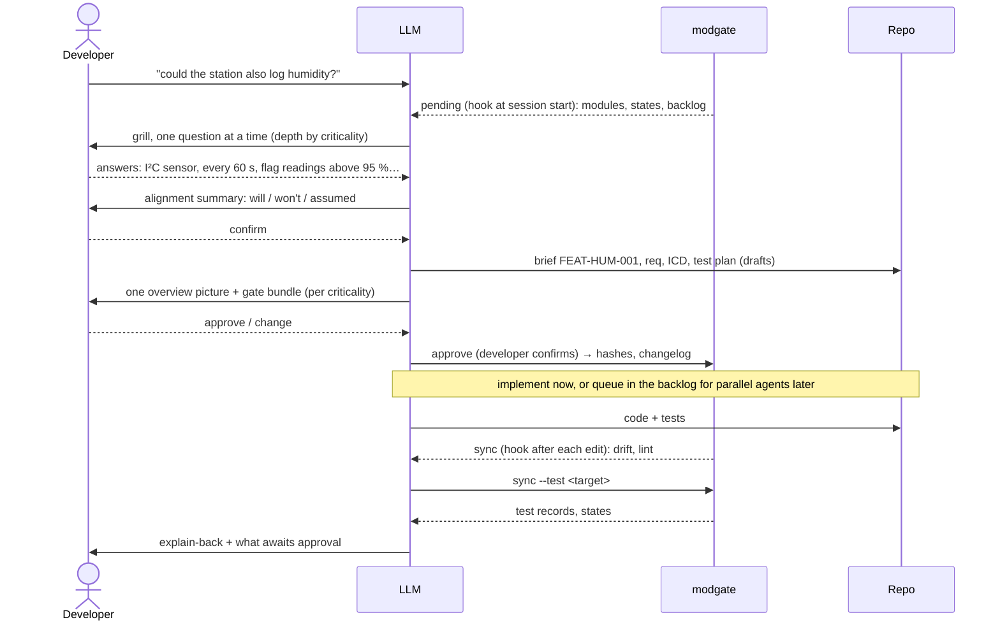
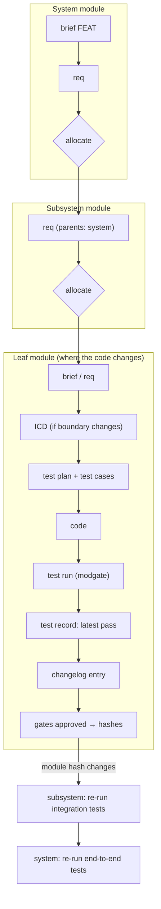

# Software Development Guideline with LLMs · v6 (approved)

> **The one doc** for building any software with AI agents: one module shape that scales from a
> helper to a whole system, docs and code you can trust, gates set by how critical the project is,
> and tools that do the mechanics. The core is fixed; domains, projects and teams add layers (§8).
> Hub: [[_Unit-Architecture]] · background: [[Unit-Architecture-Core]].

---

## 0 · Mental model


Four truths the guideline follows from:
1. **The LLM forgets between sessions.** The repository is the only memory → structured, versioned, marked trusted or not.
2. **The LLM is strong on well-defined targets, weak on vague ones.** Given a clear module spec it can validate its own work; given a vague system requirement it guesses. So it *drafts* and the developer *gates* — hardest at the top, where intent is fuzziest.
3. **The LLM is expensive and unreliable at mechanics.** Hashing, diffing, counting, matrices → **tools**; the LLM reads their output, never parses files.
4. **Tests are only as good as the idea behind them.** A flaw in a high-level intent propagates and amplifies downward, and costs most to fix late. So test *intent* is reviewed early and at the highest level; a module is trusted when approved docs, code and the latest passing test record carry the same hash.

Structural rules:
- **Everything is a module** — one shape at every level; modules contain modules.
- **Only the boundary is public** — modules meet through their ICD, never internals.
- **Ports, not platforms** — a module states what it needs; the composition root decides what provides it.
- **Requirements flow down, proof flows up.**
- **Right-size** — the simplest solution that meets the requirement; no machinery the scope doesn't need (a config file until something truly needs a config service).
- **Standards before invention** — POSIX; the project's coding standard, else Google's style guides.
- **Folders stay small** — > 8 entries warns, > 12 fails: split into child modules.

## 1 · Glossary
| Term | Meaning |
|---|---|
| **Module** | Self-contained folder: overview, docs, interface, source/content, tests, build file. Has a **kind** (§3). May contain child modules; children never know their parent. |
| **Dependency** | A module used through its interface, pinned by module hash (and git ref when it's a subrepo). |
| **Port / Adapter / Platform** | Port = interface a module needs from its environment. Adapter = module implementing a port for one platform. Platform = anything environment-specific (OS, chip, board, DB, cloud, browser). |
| **Composition root** | Top of one build or deployment: picks adapters, loads config, wires modules. |
| **FEAT** | A numbered feature in the brief, `FEAT-<MOD>-###`: the developer's intent. |
| **REQ** | A testable requirement, `REQ-<MOD>-###`, with parent FEAT/REQ IDs. |
| **ICD** | The module's boundary document; what it contains depends on the kind (§3). |
| **TC** | A test case, `TC-<MOD>-###`, naming the REQs it proves. |
| **Criticality** | L0–L3 (§2). Decides which gates the developer must approve and which an AI reviewer may. |
| **Gate** | A controlled doc that must be approved before work below it proceeds. Gates for one change arrive as one **bundle**. |
| **Resource** | External reference (datasheet, manual, standard, spec) kept in `docs/resources/` with a parsed `.md` and a hash. |
| **Deep review** | Mandatory when an approved module's hash no longer matches; the tool lists exactly what changed. |
| **Binding** | `<module>.bind.yaml`: which files implement and test each REQ; how code-only changes are caught. |
| **modgate** | The installable tool + skill (one per machine or project, never per module) that does all mechanics. |

## 2 · Criticality and gates
No tool can grade a project's criticality — **the developer decides, the LLM asks** (first session, saved in `modgate.yaml`). Children **inherit** their parent's level; a module may override it (e.g. an L1 log viewer inside an L3 infusion-pump program).

| Level | Typical | Developer must approve | AI reviewer may approve (with sign-off) |
|---|---|---|---|
| **L0 Explore** | studies, spikes, one-off scripts | findings only | everything else |
| **L1 Internal** | internal tools, internal webapps | brief (features) + req | ICD, test plan, test cases, code |
| **L2 Product** | shipped apps, product firmware | brief, req, ICD, test plan; test-case mechanics for risky modules | test cases, code (developer does explain-back) |
| **L3 Safety-critical** | regulated safety software (e.g. under DO-178C, ISO 26262, IEC 62304) | everything: **test-case mechanics** (inputs/outputs, coverage intent, framework + parameters), coverage + static-analysis reports, and a **line-by-line code review** by the developer or designer | nothing |

- **Levels are presets, not a ladder.** Each is just a list of which gates need the developer. A project that needs an in-between level defines it in `modgate.yaml` by listing its gates — nothing else changes.
- **Gates arrive as one bundle, not a dozen prompts.** For new work the LLM first shows one picture — where the module sits, its FEAT → REQ → TC chain, what needs approval — and the developer reviews the bundle in one pass. The tool keeps the pending list; the LLM walks the developer through it whenever asked.
- **AI reviewer sign-off:** where allowed, a gate the developer hasn't approved may be approved by the latest top model in a fresh session — never the session that wrote it. It is recorded as `APPROVED by ai-reviewer:<model>` — visibly different from a human approval, and `modgate sync` rejects it above the allowed level.
- **Test-case depth scales with criticality.** L1: representative cases. L3: the test plan states the strategy explicitly — e.g. a unit converter over an enum of 12 units is tested for **every** unit, not a sample; a continuous input (0–5 V) uses equivalence classes + boundaries, and the plan says which.
- **Grill until aligned (built into the skill):** before drafting anything, the LLM questions the brief one point at a time until no assumption is left unstated, then shows a short **alignment summary** — what it will build, what it won't, what it assumed — which the developer confirms. Depth scales with criticality: a few questions at L1, exhaustive at L3.
- The structure never changes with criticality — only who approves what.

## 3 · Module structure
```
battery_monitor/
├── battery_monitor.md                 # overview (controlled): kind, criticality, purpose, owns / NOT owns, deps
├── docs/
│   ├── battery_monitor.brief.md       # FEAT-BATMON-###: developer's intent, numbered
│   ├── battery_monitor.req.md         # REQ-BATMON-### (parents: FEAT or parent REQ)
│   ├── battery_monitor.icd.md         # boundary (what it is depends on the kind)
│   ├── battery_monitor.tests.md       # test plan: strategy + REQ → TC
│   ├── battery_monitor.changelog.md   # append-only history of content
│   ├── battery_monitor.activity.md    # work status: where to pick up (not controlled)
│   ├── battery_monitor.bind.yaml      # REQ → files that implement and test it (controlled)
│   ├── battery_monitor.trace.md       # GENERATED: FEAT→REQ→TC matrix, hashes, test records
│   └── resources/                     # only if needed: rm0090.pdf + rm0090.md (parsed, hashed)
├── include/battery_monitor/           # public interface (per domain: Appendix)
├── src/  test/                        # private code · this module's tests + fakes of its ports
└── CMakeLists.txt                     # or pyproject.toml / package.json
```
- Doc names: **module-prefixed, dot suffix**, never generic. Exceptions: tool-mandated names (`CMakeLists.txt`, `modgate.yaml`) and a project-level `CLAUDE.md` (agent context lives at project modules; standalone dependencies may omit it).
- Small modules may merge brief/req/ICD/tests into one doc; the tools accept both.
- **Diagrams:** Mermaid, inline in the doc they explain (default). A project may choose draw.io: `docs/diagrams/` keeps each `.drawio` source with its exported `.svg`, and the tool re-exports the SVG whenever the source changes. The LLM asks once if undecided and saves it in `modgate.yaml`.
- **Test doubles live with the port they fake**, in the port module — a sibling of the modules that use it, not inside them: `ports/hal_ports/fakes/` (`FakeAdc`, `FakeGpio`) is a test-support library any module links. Only fakes specific to one module stay in its own `test/`.
- **Resources:** a module that needs external knowledge keeps the original *and* a parsed `.md` (the parts that matter: registers, timings, errata) in `docs/resources/`. The `.md` records the original's hash; a changed original makes it stale. Same gates as other docs. Most modules have none.
- **Requirements are decomposed, not copied:** a parent requirement is split into the part each child can own and test; the parent keeps the rule that connects them, and its integration test. E.g. *"stop recording before the SD card fills"* → `storage`: report free space, raise `LOW_SPACE` below a threshold · `recorder`: stop cleanly on command within 200 ms · parent: wires the two, tests the whole. Each child REQ lists its `parents:`; a shared helper may list several.
- **Reuse:** dependencies can be subrepos shared across programs, **pinned by module hash**, so CI catches any module "out of gear".

**Module kinds** — same shape; the kind decides what the ICD is and what extra content it carries:

| Kind | Example | Its ICD is | Extra content |
|---|---|---|---|
| **code** | `battery_monitor` | header / API + behaviour, errors, timing | — |
| **system** | `weather-station` firmware image; a web product (app + database + worker) | external interfaces (e.g. its CAN frames: IDs, rates, bus load) | overview of its subsystems and how they interact (diagram), architecture (tasks, priorities, interrupts), platform (memory map, clocks, peripherals, security features; board), build + toolchain, config, resources |
| **adapter** | `hal-stm32`, `osal-freertos` | the port it implements | platform resources |
| **protocol** | `protocol/` (battery.proto) | the schema itself | generated-code targets, contract tests |
| **data** | `telemetry-db` | schema + migration contract | migrations, backup/restore, container |
| **host-service** | `probe-access`, `mqtt-broker` | what it guarantees the host (e.g. tools can open the debug probe without root; broker on port 1883) | install/config per OS (macOS, Windows, Linux) |
| **deploy** | `deploy/prod` | runbook | env config, smoke tests, secrets map |
| **tool** | `modgate`, `flash-tool` | CLI | install package with pinned dependencies |
| **study** | `study-adc-noise-floor` | question → findings | findings distilled into a resource the project can use; tests optional. When done, the LLM asks: **keep as a module, or throw away?** No loose scripts. |

## 4 · Trust: approval, hashes, test records
**Controlled docs** (overview, brief, req, ICD, test plan, resource `.md`) carry:
```yaml
version: 5                        # +1 on every change
status: draft                     # draft | approved
approved: 4 sha256:1a2b3c4d5e6f   # last approved version + body hash (12 hex shown)
```
- **Approving is a deliberate act, never the LLM's alone.** The developer doesn't type commands: the LLM proposes `modgate approve`, and the harness permission rule for it is *ask*, so the developer confirms it. AI-reviewer approval (§2) uses `--by ai-reviewer:<model>`, allowed only where criticality permits.
- **Hashes:** SHA-256, 12 hex shown, full hash in the trace file. Text normalized (UTF-8, CRLF → LF, trailing whitespace stripped, one final newline); binary raw. Doc hash = body only (modgate strips frontmatter, so approving never changes a hash). **Module hash** = SHA-256 of sorted `<path>\t<file-hash>` lines (all files except trace, changelog, activity) + one `dep:<module>\t<module-hash>` line per dependency.

**Module states** — computed by `modgate`, never guessed:
| State | Condition | Consequence |
|---|---|---|
| **verified** | gates approved · module hash = approved hash · latest passing record = module hash on every required target | Source of truth. |
| **approved, untested** | approved, no passing record for the current hash | Run tests; record. |
| **draft** | any gate is `draft` | Proposal only; the LLM says so before building on it. |
| **stale → deep review** | approved, module hash ≠ approved hash | Tool lists changed files; review first. |
| **dependency changed** | a dependency's hash changed | ICD unchanged → re-run tests. ICD changed → deep review. |
| **unreviewed change** | a source/test file changed but the REQ/test docs bound to it were not revisited (e.g. a debounce changed from 1 s to 2 s in code and test only) | The LLM revisits the bound docs — updates them, or logs "no requirement impact" — before the gate bundle goes to the developer. |

**Test record** — only the **latest passing** run per target (history is in git), with its environment:
```yaml
target: stm32f4-board
module_hash: sha256:7c1e0a9b44d2
result: pass (14/14)
date: 2026-09-26
env: {os: FreeRTOS 11.1, arch: armv7e-m, endianness: little, compiler: arm-none-eabi-gcc 13.3}
deps: {filters: sha256:ab12cd34ef56, hal_ports: sha256:3d4e5f607182, osal_ports: sha256:99aa11bb22cc}
```

## 5 · Changelog and activity log
| | `<module>.changelog.md` | `<module>.activity.md` |
|---|---|---|
| Answers | *How did this module become this version?* | *Where is the work, and where do I pick up?* |
| Edited by | LLM appends; `sync` validates IDs + append-only | LLM, kept current |
| Rules | append-only, entry ID = date + 4 random hex, `merge=union` | mutable; one line per FEAT: status · next step · blockers |
| Controlled? | record, not a gate | no |

Planning and building rarely happen in one sitting. The activity log is also the **backlog**: approved work waits there, and queued items for disjoint modules can be handed to parallel agents later — overnight, in a slow week, or when token budget allows. Any session can resume at any stage.
```markdown
### 2026-09-26-a3f9 · v4 · battery_monitor.icd.md · AI
- Sample period 100 ms → 50 ms. Why: FEAT-BATMON-002 faster brown-out detection. Awaiting approval.
```

## 6 · How work flows
**How the developer works with the LLM** — the developer just talks; the LLM maps it onto the process and asks for gates:


**How a change propagates** — down through allocation, proof back up:


**Trigger table** — changes flow **down and sideways only**. Correcting a lower doc (e.g. the developer asks for a better test plan) never reopens the levels above it; only the automatic re-verification (tests) flows up.
| When this changes | This must follow |
|---|---|
| brief | req |
| req | test plan, test cases; child REQs |
| ICD | code, tests; **deep review of dependents** |
| code | its bound docs revisited; test run; parents re-test |
| test plan / case | test run |
| dependency | re-test; ICD changed → deep review |
| resource original | re-parse its `.md`, re-approve |
| any controlled doc | version +1, draft, changelog |

## 7 · modgate — the tool
> **Provisional.** For now modgate is the set of routines that make the LLM reliable (hashing, drift, trace, pending gates); its interface will change as the pilot teaches us. Kit + example: `~/workspace/Modgate` (`kit/` installs into a project, `example/weather-station/` shows the whole structure).

**One installable, isolated tool module**: Python, `pyproject.toml` with pinned deps, `uv tool install modgate` (or pipx) on macOS, Windows, Linux. It ships the CLI, the Claude skill, the hooks + permission rule and the module templates. **The developer never runs it** — hooks run it, the LLM reads one-line findings; only `approve` asks the developer.

Three verbs: everything mechanical is `sync`; everything human is `pending` → `approve`.

| Command | Does | Runs |
|---|---|---|
| `sync [path…]` | Rehash (incremental cache) · verify approved hashes · **drift** via bindings · regenerate `*.trace.md` · draw.io → SVG · tests (`--test <target>` runs the target's command, keeps the latest passing record) · scaffold missing docs for any overview with `kind:` · lint (naming, append-only logs, approver vs criticality, pinned deps). Silent on success. First run in a project writes `modgate.yaml` + hooks. | PostToolUse (edited file), Stop, CI `--strict` |
| `pending` | One line per module with open work: draft gates, drift, deep reviews, untested targets, backlog — grouped into dependency-disjoint sets. `--report` renders the whole-project view (every module top to bottom, trace matrix, platform + config inventory). | SessionStart, on demand |
| `approve <module> <doc\|REQ\|all> [--by ai-reviewer:<model>]` | Records hashes, sets status, appends the approval entry; rejects AI sign-off above the allowed level. | LLM proposes, developer confirms (permission rule *ask*) |

**Output:** one line per finding, `CODE module id files → next action`; exit 0 clean · 1 findings · 2 violations · 3 error. `--json` only when asked.
```text
DRIFT    uart_dma  REQ-UART-002  src/uart_dma.cpp test/test_uart_timeout.cpp  → review req/TC or approve REQ-UART-002
DRAFT    uart_dma  uart_dma.icd.md v4  → approve (developer, L2)
UNTESTED uart_dma  stm32f4-board  → sync --test stm32f4-board
E:APPROVER telemetry_db  telemetry_db.tests.md  ai-reviewer at L3
```

**Binding** — `docs/<module>.bind.yaml`, controlled (hashed, in the module hash): each REQ → the files that realize and test it. `sync` keeps per-REQ section hashes and per-file hashes in the trace file; a bound file changed while its REQ section did not → `DRIFT`. Cleared by editing the req (normal gate flow) or `approve <module> REQ-…` ("reviewed, requirement unaffected"). Source bound to nothing → `UNBOUND`.
```yaml
REQ-UART-001: [src/uart_dma.cpp, test/test_uart_rx.cpp]
REQ-UART-002: [src/uart_dma.cpp, include/uart_dma/uart_dma.hpp, test/test_uart_timeout.cpp]
```

**Backlog** — queued items live in each module's activity log (`- [ ] FEAT-UART-003 · after: filters`). `pending` collects them and partitions them into disjoint module groups; an orchestrating session launches one agent per group (isolated worktree), each ending with `sync`. Approvals still wait for the developer.

**Hooks** (written by the first `sync`, project or user scope):

| Hook | Command | Effect |
|---|---|---|
| SessionStart | `modgate pending` | State in context at turn 0 |
| PostToolUse Edit/Write | `modgate sync <file>` | Drift/lint right after the edit, no LLM turn |
| Stop | `modgate sync` | Blocks stop only on violations (exit 2) |
| Permission | `Bash(modgate approve*)` → ask | Approval stays a developer act |

**Project settings** (`modgate.yaml`; the LLM asks once for anything missing):
```yaml
project: weather-station
criticality: L2
diagrams: drawio
coding_standard: google
targets: {linux-sim: "ctest --test-dir build/sim", stm32f4-board: "pytest hil/ -m board"}
guidelines: [firmware, docs/weather-station.guideline.md]
```

## 8 · Guideline layers — extensible per domain, project and team
```text
core (this doc)  →  domain appendix  →  project guideline  →  module overrides
never changes       adds per domain     e.g. "every public API    e.g. admin-console: L1,
                                         is versioned + paged"   "no animations in kiosk UI"
```
Every layer may **add** rules and set criticality; none may break the core invariants (module shape, gates, hashes, append-only changelog, tools for mechanics). A team with deep domain expertise tightens its own layer's gates and requirements; where no expert exists, the LLM derives requirements and tests itself at the criticality chosen — good enough for the purpose, still fully traceable.

**Writing a layer is guided:** the skill includes a setup conversation in which the LLM talks the developer or team through their domain — standards they follow, gates they want, naming, test depth — and writes the result as their project guideline and config, for them to approve like any other doc.

## 9 · Rules for the LLM (shipped in the modgate skill)
```markdown
## Development rules (Dev-Guideline-with-LLMs)
- Hooks run modgate: its `pending` lines are in context at session start, `sync` lines after each edit.
  Act on those lines; never read whole trees to find what changed.
- If criticality, diagram tool or coding standard is unset, ask once and save it in modgate.yaml.
- The developer prompts naturally: map the prompt onto brief → grill → req → ICD → test plan → code,
  and ask for the gates their criticality requires. Grill one question at a time.
- Trust only `verified` modules. Drafts are proposals — say so. `approved, untested` → `sync --test`.
  Stale or dependency-changed → tell the developer; deep review first.
- Before editing a module, read its overview, approved req and ICD (and parsed resources if any).
- Never change code without revisiting the docs bound to it: a code-only change is flagged as
  an unreviewed change until its REQ/test docs are updated or logged as "no requirement impact".
- Present gates as one bundle with one overview picture, never a stream of separate approvals.
- Any controlled-doc change: version +1, status draft, append a changelog entry. Keep activity.md current;
  keep bind.yaml current when a REQ gains or loses files.
- Changes flow down only; never reopen upstream docs unless the developer asks.
- Never approve on your own: `modgate approve` needs the developer's confirmation, or an AI-reviewer
  sign-off where criticality allows. Never write approval or test-record entries by hand.
- Stay inside the module; others only through their interface. No platform code outside adapters.
- New throwaway script → make it a `study` module; when done, ask: keep or throw away?
- Code style: modgate.yaml standard, else Google. Diagrams: modgate.yaml choice, else Mermaid.
- Anything mechanical → modgate, never by reading files. Session end: `pending` + what awaits approval.

## How to change code (after Andrej Karpathy's notes on LLM coding pitfalls)
- Think first: state assumptions; if the request is ambiguous, ask instead of guessing.
- Simplest thing that works: no speculative features, options or abstractions.
- Surgical: touch only the lines the task needs; don't reformat, rename or "improve" nearby code.
- Goal-driven: define how success is checked (a failing test first), then loop until it passes.
```

## 10 · Example — `battery_monitor` (code module, L2)
A complete example project — system, subsystems, ports with shared fakes, adapters, protocol, backend, data, dashboard, deploy, host service, study — lives in the kit repo at `example/weather-station/`, in a realistic mixed state (verified modules, one draft gate, one drift, backlog). The excerpt below is one of its modules.

`docs/battery_monitor.brief.md`: `FEAT-BATMON-002 — warn before brown-out, early enough to save state.` → `REQ-BATMON-002 (parents: FEAT-BATMON-002, REQ-PWR-004) — Raise LOW_BATTERY when voltage < 3300 mV for 1 s.`
```cpp
class BatteryMonitor {                        // include/battery_monitor/battery_monitor.hpp
 public:
  BatteryMonitor(hal::Adc& adc, osal::Clock& clock, filters::MovingAverage& avg);
};
TEST(BatteryMonitor, REQ_BATMON_002_raises_low_battery_after_1s_below_3300mV) {
  FakeAdc adc{3200}; FakeClock clock; filters::MovingAverage avg{8};
  BatteryMonitor mon{adc, clock, avg};
  clock.advance(1000ms);
  EXPECT_TRUE(mon.low_battery());
}
```
`docs/battery_monitor.trace.md` (generated) renders as a matrix — state: **verified** · module `sha256:7c1e0a9b44d2` (approved ✓):

| FEAT | REQ | Test cases | linux-sim | stm32f4-board |
|---|---|---|---|---|
| FEAT-BATMON-002 | REQ-BATMON-002 | TC-BATMON-003 | ✓ pass | ✓ pass |
| FEAT-BATMON-001 | REQ-BATMON-003 | → allocated to `filters` (REQ-FILT-004) | ✓ pass | ✓ pass |

The project-wide version of this matrix (every module, top to bottom) is the tool's report.

---

# Appendix — domain specifics (add to the core, never contradict it)
Each domain defines only: public-interface folder, build file, test framework + how tests carry REQ IDs, adapters, composition roots, test-record environment fields.

## A · Firmware / embedded C++
- **Ports:** OSAL (thread, mutex, queue, timer, clock) · HAL (GPIO, I²C, SPI, UART, ADC, DMA). **Adapters:** `osal-freertos`, `osal-posix`, `hal-stm32`, `hal-linux-sim`.
- **Composition roots (targets):** `targets/stm32f4-board/`, `targets/linux-sim/`. **linux-sim** = the firmware built natively for the developer's machine: OSAL → POSIX threads and timers, HAL → simulated peripherals (ADC values from files/sockets, GPIO as state, UART over a pty). It runs every module and subsystem test in CI in seconds; hardware is needed only for HIL. Its own overview (`targets/linux-sim/linux-sim.md`) documents what each simulated peripheral does.
- **System module** (the firmware image): architecture doc (tasks, priorities, interrupts, module interactions), platform doc (chip + board features), board config as data, toolchain file, resources (reference manual, datasheets — parsed). Application code never touches assembly, so architecture and compiler stay abstracted but are still recorded in test environments.
- **Tests:** GoogleTest/Catch2, REQ in the test name; HIL at system level per board. **Env:** RTOS + version, MCU/arch, endianness, compiler, board revision.
- Hazard rules (ISR, DMA, watchdog, timing) → a nested `CLAUDE.md` in that module only.
```cmake
add_library(battery_monitor src/battery_monitor.cpp)
target_include_directories(battery_monitor PUBLIC include)
target_link_libraries(battery_monitor PUBLIC hal_ports osal_ports filters)
if(PROJECT_IS_TOP_LEVEL)
  add_subdirectory(test)          # module's own tests build standalone
endif()
```

## B · Host tools and host services (macOS, Windows, Linux)
- **Tools:** mostly pure modules; OS APIs behind a thin port. Python: one package per module (`pyproject.toml`, pinned deps), pytest with a REQ marker. Each tool states its supported OSes. **Env:** OS + version, arch, interpreter/compiler.
- **Host services** are `host-service` modules that set up what tools depend on, per machine: debug-probe drivers and udev rules, a local message broker, a package cache. A flashing tool that needs the probe lists `probe-access` as a dependency; `probe-access` installs and verifies it on each supported OS.
```python
@pytest.mark.req("REQ-CSVX-002")
def test_rejects_rows_with_missing_timestamp(): ...
```

## C · Backend services and data
- **Ports:** repository, clock, HTTP client, queue, secrets. **Adapters:** `repo-postgres`, `repo-sqlite`, `http-httpx`, `queue-redis`. **Composition root:** the app entry point per deployment; the framework is an adapter at the edge.
- **Data modules** own a database: schema, migrations, migration/backup/restore scripts, container definition. Services depend on the data module's schema (its ICD).
```python
class BudgetService:                       # module: budget_service
    def __init__(self, repo: TxRepository, clock: Clock): ...
# composition root (main.py): BudgetService(PostgresTxRepository(cfg.db_url), SystemClock())
```
- **Env:** runtime version, DB engine + version, container image digest.

## D · Frontend / webapp
- **Module = feature folder** (components, state, API use, tests, docs); shared UI = a design-system module. **Ports:** API client (generated from the backend's ICD schema), storage, router, auth. **Composition root:** app bootstrap (real vs mock API).
- REQ in the test title: `it("REQ-DASH-003 shows low-battery banner")`. **Env:** browser + version, OS, viewport.
- Criticality varies widely by app; a team with frontend expertise raises the gates in its own guideline layer (§8).

## E · Integration between domains
- **The system module that spans domains documents its subsystems and how they talk** — e.g. a web product's overview shows app, database service and worker, with one interaction diagram; each arrow names the protocol module it uses.
- **A protocol is a module like any other** (kind `protocol`): `protocol/protocol.md` + `docs/protocol.icd.md` + the schema (`battery.proto`, OpenAPI, JSON Schema) + contract tests. Code for every side is generated from it; its hash is a dependency of every side, so a schema change triggers deep review on all of them.
```text
protocol/ (kind: protocol) → firmware/comm (nanopb C) · backend/ingest (Python) · frontend/dashboard (TS)
```

## F · Hosting / deployment
- **Right-size the pipeline to the requirement.** Start with the smallest thing that meets it — one host, one process, a cron job — and add tiers (replicas, queues, orchestration) only when a requirement demands them, with that requirement as the parent.
- **A deployment is a `deploy` module** (a composition root): `deploy/<env>/` with overview, runbook (its ICD), config as data, smoke tests, compose/systemd/k8s files, backup + restore.
- **Secrets:** values live only in the host's secret store (OS keychain, systemd/docker secrets, cloud secret manager, password manager); the module's docs keep a **secrets map** — which secret, where it lives, who rotates it — never the value.
- `verified` = smoke tests passed against the current hashes of everything it deploys. **Env:** host OS + kernel, arch, image digests, config hash.

---

## Open questions
- [ ] Pilot: apply this structure by hand to one real work module, then build the tool from what the pilot needs.

## Changelog
### 2026-09-26-0001 · v1 · this doc · AI
- Created: consolidates [[Unit-Architecture-Core]] + approval/changelog rules into one guideline.
### 2026-09-26-0002 · v2 · this doc · AI
- Applied the developer's review of v1: "module" everywhere; mental-model section; glossary; docs/ layout with brief + trace; hash spec (SHA-256, normalization, module hash with deps); module states + deep review; latest-passing test records with environment; dependency allocation with multiple parents; conflict-free changelog (union merge); change-propagation diagram + trigger table; modkit skill pack (tools for mechanics); coding standard default Google; detailed appendix (firmware, host, backend, frontend, integration, hosting). Awaiting review.
### 2026-09-26-0003 · v3 · this doc · AI
- Condensed to ~55% of v2 with no rule dropped: merged Principles into the mental model; collapsed glossary rows (port/adapter/platform, REQ/ICD/TC) and dropped terms defined in §3; dropped the Python hash snippet (spec bullets are the source), the redundant "A · Generic" appendix and duplicated prose between glossary, states and trigger table; merged checkpoints into §6; fixed trace example to `TC-<MOD>-###` IDs. Awaiting review.
### 2026-09-26-4bd2 · v3 · this doc · AI
- Correction to entry 0003: v3 is 78% of v2's lines (286 vs 368), not ~55%; the rest is mandated diagrams, tables, rules and examples. IDs 0001–0003 predate the date+random format and are kept as-is (append-only).
- Fixed from Fable's review + the developer's answers: doc hash strips frontmatter (approval never changes a hash); overview `<module>.md` is a controlled doc; test-record deps include `hal_ports`/`osal_ports`; changelog IDs = date + 4 random hex; LLM rule for `approved, untested`; folder-limit open question narrowed to warn vs fail. Awaiting review.
### 2026-09-26-1cbf · v4 · this doc · AI
- Applied the developer's review of v3 (36 notes): criticality levels L0–L3 with gates + AI-reviewer sign-off (§2); truths 2 and 4 refined (vague vs well-defined targets; flawed intent amplifies downward); module kinds (code, system, adapter, protocol, data, host-service, deploy, tool, study) with kind-specific ICDs; resources in docs/resources/ with parsed, hashed .md; FEAT numbering in the brief; activity log beside the changelog; developer prompts naturally, approval confirmed via harness permission; developer↔LLM sequence diagram; changes flow down only; modkit as an installable Python tool module with `report` (whole-project view) and `modkit.yaml` project settings; Mermaid default, draw.io per project; guideline layers (core → domain → project → module); folder limit > 8 warn, > 12 fail; project-level CLAUDE.md allowed; subrepo deps pinned by hash; linux-sim defined; host services and data modules; secrets map. Skills cherry-pick settled: grill (K2) and test-plan depth (K4) folded into §2/§6; K1 via resources + brief; K3, K6 already covered; D1 dropped (features live in the brief); D2 relaxed for project-level CLAUDE.md. Awaiting review.
### 2026-09-26-dc8c · v4 · this doc · AI
- Replaced examples lifted from the developer's review notes with original ones illustrating the same rules (humidity-logging conversation, weather-station system module with CAN interface, probe-access / mqtt-broker host services, study-adc-noise-floor, unit-converter test depth, log-viewer override, generic guideline-layer rules). the developer's notes are intent, not example text.
### 2026-09-27-bc0f · v5 · this doc · AI
- Applied the developer's review of v4 (31 notes): structural rules as a list, `#ifdef` dropped, new right-size rule; FEAT/REQ/ICD/TC back as separate glossary rows; criticality inherited from parent, L2 may add test-case mechanics, L3 adds line-by-line code review, levels as gate presets (in-between levels via config), gates as one bundle with an overview picture, AI reviewer = latest top model in a fresh session; requirements decomposed not copied (own example); shared test doubles live with their port; draw.io source + auto-exported SVG; system modules document subsystems + interactions; "unreviewed change" state; activity log doubles as backlog for parallel agents; Karpathy-style change rules + "never change code without its bound docs"; guided setup for team guideline layers; right-size hosting; trace example as a real matrix.
- §7 replaced with Fable's token-lean design: tool renamed modkit → **modgate**; 8 commands → 3 verbs (`sync`, `pending`, `approve`) run by hooks; one-line findings, silent on success; per-module `bind.yaml` (REQ → files) detects code-only drift; backlog kept in module activity logs (not a root file) to keep modules self-contained.
### 2026-09-27-1296 · v6 · this doc · AI
- Applied the developer's review of v5: grill-until-aligned built into the skill, ending in an alignment summary the developer confirms (§2, §6 diagram); shared fakes clarified as living in the sibling port module; §7 marked provisional (routines for LLM reliability, interface will change); pointers to the kit repo `~/workspace/Modgate` and its `example/weather-station/` project. Tool name modgate confirmed.
### 2026-09-27-eeed · v6 · this doc · APPROVED by the developer · sha256:3cb3fd7b82d8
- Approved in chat 2026-09-27. Hash = modgate text_hash of the body above `## Changelog` (frontmatter and this log excluded, since the log lives inside the doc).
