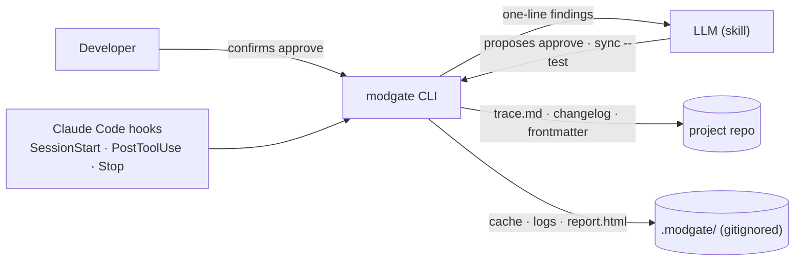

# modgate · tool

The installable kit that does the mechanics of [Dev-Guideline-with-LLMs](kit/guideline/) so the LLM
doesn't have to: hash, detect, trace, record, report. Three verbs — `sync` (everything mechanical),
`pending` → `approve` (everything human). Hooks run it; the LLM reads one-line findings; only
`approve` asks the developer.

## Purpose
Make an LLM reliable at gated module development by taking every mechanical step away from it.

## Owns
- The hash spec, module states, drift detection, trace files, test records, lint, the pending list.
- The kit: Claude skill, hooks snippet + permission rule, module templates, `install.sh`.

## Does NOT own
- The guideline text (copied into `kit/guideline/` by whoever packages the kit).
- Grading criticality (the developer decides; the skill asks once).

## Supported OSes
macOS and Linux (bash installer). Windows: CLI is portable Python; installer is a TODO.

## Layout
| Path | Holds |
|---|---|
| `src/modgate/` | the package (`cli`, `analyze`, `approve`, `project`, `hashing`, `trace`, `report`) |
| `test/` | pytest; each test carries `@pytest.mark.req("REQ-MG-###")` |
| `kit/` | what `install.sh` puts into a project |
| `example/weather-station/` | a demonstration project in the format (never deployed) |

## Install
`./install.sh <project-dir>` — details in [modgate.icd.md](docs/modgate.icd.md).
